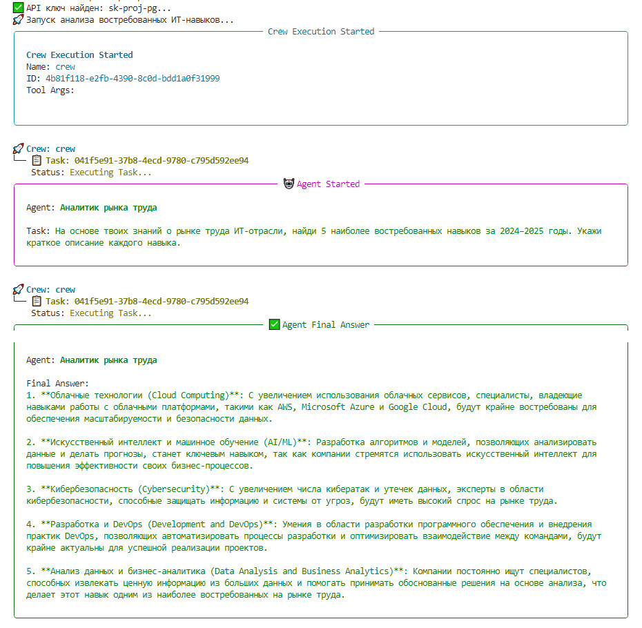
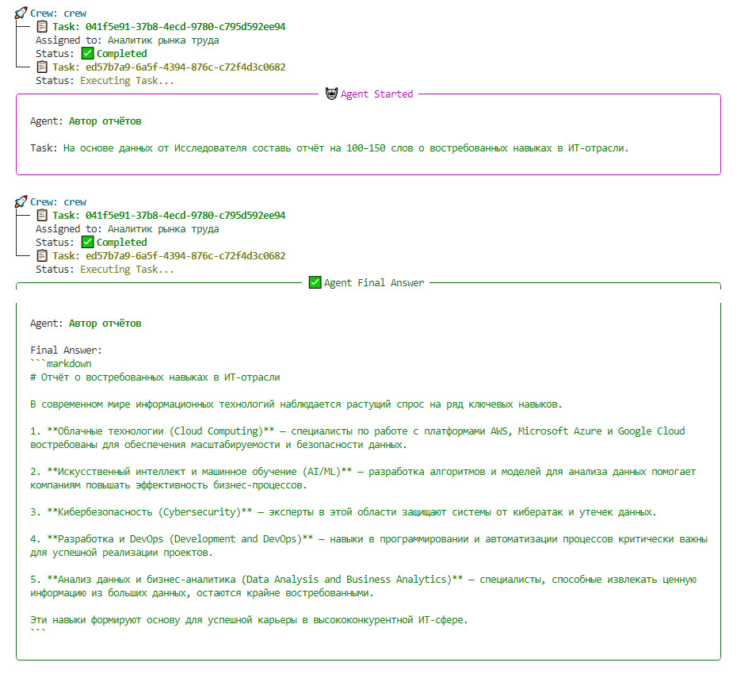
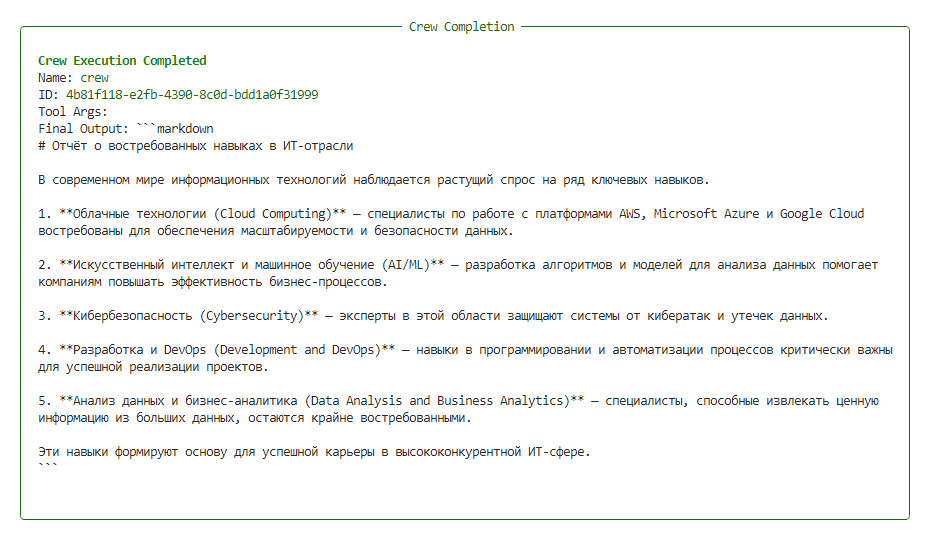

# AI-Assistant-CrewAI

Интеллектуальная агентная система на базе CrewAI с автоматическим выбором LLM (OpenAI или локальная Ollama) для анализа рынка труда и генерации аналитических отчётов.

---

## 📌 Описание проекта
**AI-Assistant-CrewAI** — это модульная система, использующая агентный фреймворк *CrewAI*. Проект автоматически определяет доступную языковую модель: если запущена локальная система Ollama — используется она, иначе применяется OpenAI API. Это делает приложение универсальным, надёжным и удобным для разработки.

Система состоит из двух агентов:
- **Аналитик рынка труда** — собирает данные о наиболее востребованных навыках.
- **Автор отчётов** — формирует структурированный отчёт на основе собранной информации.

Общая логика вынесена в отдельный модуль `common.py`, исключая дублирование и упрощая поддержку.

---

## 🚀 Основные возможности
- Автоматическое определение доступного LLM (Ollama → OpenAI fallback)
- Агентное взаимодействие через CrewAI
- Чистая архитектура: общий модуль + два варианта запуска
- Расширяемость: легко добавлять агентов, задачи и модели
- Обработка ошибок Ollama/OpenAI
- Возможность локального офлайн‑запуска через DeepSeek и другие модели

---

## 📂 Структура проекта
```
project/
├── common.py              # Общая логика агентов и задач
├── crew_labour.py         # Основной запуск с авто‑выбором LLM
├── crew_labour_ollama.py  # (Опциональный) Чистая версия под Ollama
├── .env                   # Настройки OpenAI
└── README.md              # Описание проекта
```

---

## ⚙️ Установка и запуск

### 1. Установка зависимостей
```
pip install crewai python-dotenv requests
```

### 2. Настройка OpenAI в `.env` (если Ollama недоступен)
```
OPENAI_API_KEY=your-key
OPENAI_API_BASE=https://api.openai.com/v1
```

### 3. (Опционально) Настройка Ollama
- Установите Ollama: https://ollama.ai
- Скачайте модель:
```
ollama pull deepseek-r1:8b
```
- Запустите сервер:
```
ollama run deepseek-r1:8b
```

### 4. Запуск проекта
```
python crew_labour.py
```
Скрипт сам определит, какую LLM использовать.

---

## 🧠 Как это работает
1. Скрипт проверяет доступность локального Ollama.
2. Если Ollama запущен → используется локальная модель через HTTP API.
3. Если нет → подключается OpenAI.
4. Через `common.py` создаются агенты и задачи.
5. CrewAI orchestration запускает цепочку действий.
6. Итоговый отчёт выводится в консоль.

---

## 📈 Пример результата
```
- Навык 1: ...
- Навык 2: ...
...
## Итоговый отчёт
(100–150 слов в формате markdown)
```

**Итог работы агента "Аналитик рынка труда"**


**Итог работы агента "Автор отчётов"**


**Итог работы проекта**


---

## 🛠️ Технологии
- Python 3
- CrewAI
- OpenAI API
- Ollama / DeepSeek
- dotenv
- requests

---

## 🔧 Возможности расширения
- Добавление новых агентов (HR‑аналитика, финансовый аналитик и т.д.)
- Поддержка нескольких локальных моделей
- Интеграция в веб‑панель (Streamlit / FastAPI)
- Генерация PDF‑отчётов

---

## 📜 Лицензия
MIT (можно изменить при необходимости)

---

## 💬 Автор
Проект создан как демонстрация гибридной архитектуры LLM и возможностей CrewAI.

